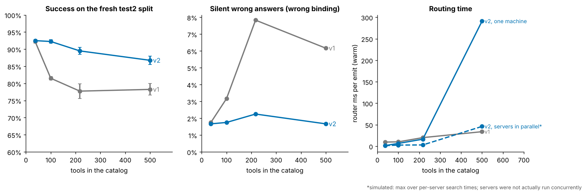
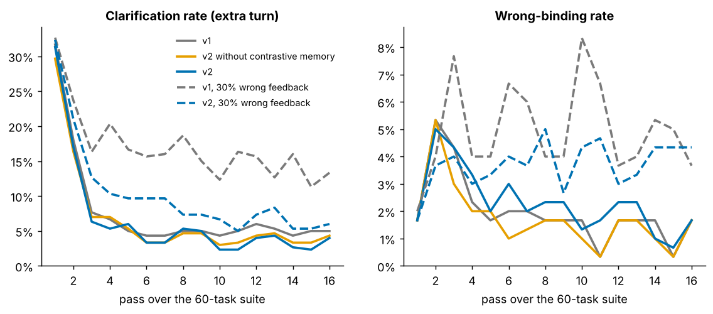
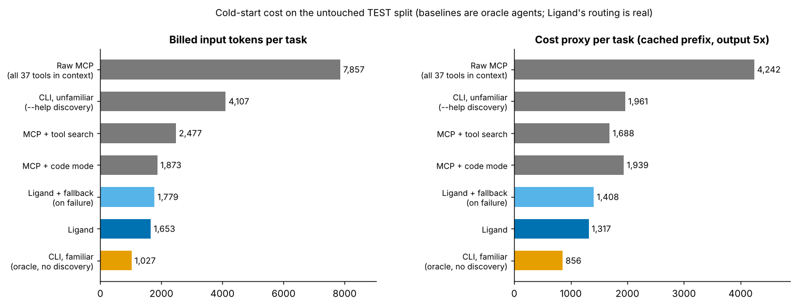
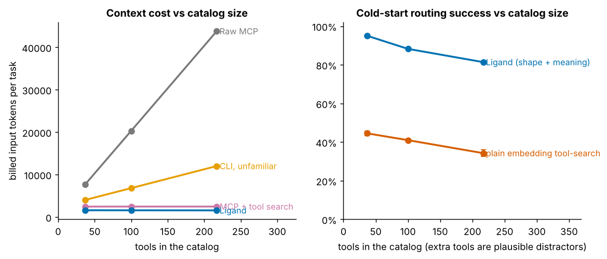
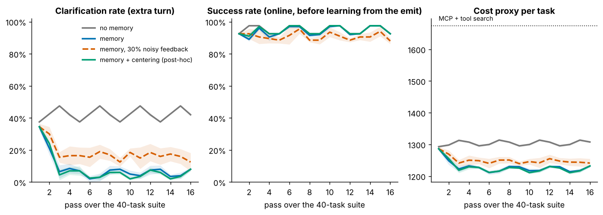

# Ligand: results, and what they do not show

Two iterations, both measured. **Part 1 is v2** (type-address gate + adjacency index + per-server bidding + contrastive memory).
**Part 2 is v1** (the first prototype), kept as written. Means over 5 world seeds; seeds change the data but not the 30 task templates
(× 2 instantiations × 4 phrasings = 240 distinct emits per run), so read the ± as "world variation", not as statistical confidence.

# Part 1: v2

## TL;DR
1. **The accuracy loss at scale is mostly fixed.** On the fresh test2 split (10 templates written *before* v2 existed, never used for tuning),
   v1 → v2 success: 37 tools **92.3% → 92.5%** (no change), 100 tools **81.5% → 92.2%**, 217 tools **77.8% → 89.5%**, 500 tools **78.2% → 86.8%**.
   Silent wrong answers (confident wrong binding): 217 tools **7.8% → 2.2%**, 500 tools **6.2% → 1.7%**.
2. **The two ideas are complementary, neither is enough alone** (217 tools, test2): type gate + index alone 86.8% / 0.8% wrong but **2.9 s per call** and 51% clarifications;
   bidding alone 89.2% / **5.8% wrong**; both 89.5% / 2.2% / 16 ms.
3. **Speed is not solved at 500 tools.** Routing is 16 ms at 217 tools (v1: 20) but **291 ms at 500 tools** (v1: 34) on one machine.
   A simulated "servers search concurrently" figure is 46 ms, but I did not actually run servers concurrently.
4. **What v2 did NOT fix:** wording shift after learning (below), and paraphrase misses that come from the lexical embedding.

## Cold start, v1 vs v2 (5 seeds)
| tools | engine | dev | test* | **test2 (clean)** | wrong-bind | ask rate | router ms (one machine) | router ms (servers parallel, simulated) |
|---|---|---|---|---|---|---|---|---|
| 37 | v1 | 95.0% | 95.0% | **92.3%** | 1.7% | 40.7% | 10 | 10 |
| 37 | v2 | 97.5% | 95.0% | **92.5%** | 1.7% | 26.5% | 2 | 1 |
| 100 | v1 | 86.8% | 89.8% | **81.5%** | 3.2% | 36.6% | 10 | 10 |
| 100 | v2 | 97.5% | 94.8% | **92.2%** | 1.7% | 27.6% | 7 | 3 |
| 217 | v1 | 86.0% | 76.7% | **77.8%** | 7.8% | 33.0% | 20 | 20 |
| 217 | v2 | 97.5% | 93.8% | **89.5%** | 2.2% | 27.7% | 16 | 3 |
| 500 | v1 | 83.8% | 74.0% | **78.2%** | 6.2% | 33.8% | 34 | 34 |
| 500 | v2 | 97.5% | 92.8% | **86.8%** | 1.7% | 29.0% | 291 | 46 |

Provenance: dev (t01–t10) tuned v1's thresholds and informed the type gate; **test\* (t11–t20) was seen when I diagnosed v1's failures, so it is not clean for v2**;
test2 (t21–t30) is the only split v2 was not designed against. Quote test2.
Extra tools are synthetic distractors in duplicated systems ("legacy tickets", "partner invoices") with near-identical shapes: a hard-but-artificial setting.

## Where the gain comes from (217 tools)
| engine | dev | test* | test2 | wrong-bind | ask rate | router ms |
|---|---|---|---|---|---|---|
| v1 | 86.0% | 76.7% | 77.8% | 7.8% | 33.0% | 20 |
| + type gate, index, goal-directed search (one global search) | 95.0% | 88.0% | 86.8% | **0.8%** | 51.0% | 2,902 |
| + per-server bidding only (no type gate) | 95.0% | 83.0% | 89.2% | 5.8% | 37.9% | 39 |
| v2 without contrastive memory | 97.5% | 93.0% | 89.2% | 2.4% | 37.1% | 16 |
| **v2 (all)** | 97.5% | 93.8% | 89.5% | 2.2% | 27.7% | 16 |

- **Type gate** (a closed list of schema nouns: id, name, email, title…; conflicting types cannot bind) removes type errors such as `database_name` → `database_id` and `author_email` → `author`. This is what drives wrong-binding down.
- **Bidding** (each server searches only its own tools; servers that own nothing the agent's `have` can feed or filter abstain; calibrated per server) fixes the pruning loss and the cost of global search.
- **Adjacency index + goal-directed pruning** (only chains whose last step produces a wanted field; only prefixes that can still reach one) gave identical decisions to the full scan (240/240) at 3-4× less time.
- **Contrastive memory** (when the agent resolves an `ask`, the rejected candidates are recorded as negatives): clarifications 37.1% → 27.7% with no accuracy change. *Caveat:* it learns from picks *during* the run, so "cold" v2 is not purely cold; v1 has no such signal.

## Learning (16 passes, online)
| engine | feedback | ask rate (passes 3–16) | success | wrong-bind |
|---|---|---|---|---|
| v1 | clean | 5.2% | 94.8% | 1.8% |
| v2 | clean | 4.0% | 94.8% | 2.2% |
| v1 | 30% wrong | 15.5% | 91.2% | 5.2% |
| v2 | 30% wrong | **7.9%** | 92.9% | 3.9% |

Clean feedback: no real difference. **v2 is more robust to bad feedback** (half the clarification rate, fewer wrong answers).

## Wording shift after learning: NOT fixed
Train on new-parameter-free instantiations with wording A/B, test on new parameters with wording C/D:
| engine | cold success | trained success | cold wrong | trained wrong |
|---|---|---|---|---|
| v1 | 88.3% | 84.7% | 3.3% | 8.3% |
| v2 | 90.0% | 85.0% | 3.3% | 8.0% |

Learned shortcuts still fire on differently-worded goals of confusable tasks. Contrastive memory did not change this. Still open.

## Tokens per task, 37 tools, test2 split (cold; baselines are oracle agents)
| | input tokens | cost proxy |
|---|---|---|
| Raw MCP | 7,182 | 4,078 |
| CLI, unfamiliar | 3,655 | 1,806 |
| MCP + tool search | 2,297 | 1,584 |
| MCP + code mode | 1,869 | 1,823 |
| **Ligand v2** | **1,454** | **1,189** |
| Ligand v1 | 1,560 | 1,222 |
| CLI, familiar (idealised) | 927 | 771 |

Agent-visible context stays ~1.5k tokens at any catalog size. An idealised "the model already knows the CLI" baseline is still cheaper.

## Real MCP end to end (v2 engine)
Agent → Ligand MCP server → 6 ordinary stdio MCP servers. The agent saw **one tool (286 tokens)**; the same servers directly: 37 tools, 2,881 tokens.
60 tasks cold: **56/60** correct, 18 clarifications. Server restarted, memory loaded from disk: 54/60, 4 clarifications. Median call 14–17 ms.

## What remains wrong (per template, 217 tools)
Fixed by v2: t11 (0% → 100%), t26 (25% → 100%), t03, t07, t08, t16, t17, t28 (all → 100%). Still weak, all on the *paraphrase* phrasing:
t21 (45%: agent says `state`, tool says `status`), t12 (62.5%), t06, t18, t22, t23 (75%: `login`/`assignee`, `branch`/`name`, `chat`/`slack`). These are vocabulary gaps a real embedding model should narrow; I could not test one.

## What this does NOT show
- **No LLM in the loop.** An oracle writes `have`/`want`, picks from `ask`, fixes `need`. Baselines are oracle agents. The decisive test is a real model driving Ligand.
- **Self-authored world, tools, tasks and distractors.** test2 was written before v2 but after v1, by the same author, in the same world.
- **The type gate uses a closed noun list** I chose after seeing failures on dev/test; real schemas should supply types (`format: email`, `uri`, …) instead.
- **Parallel speed is simulated** (max over per-server search time); latencies were measured with two benchmark processes sharing two cores.
- **500-tool latency (291 ms) is a real weakness**: per-domain servers with ~45 tools each search exhaustively.
- Lexical embeddings only; no pretrained model was reachable. Needs `outputSchema` on tools. Read-only tasks; no auth or write-safety model.

---

## Part 2: v1 results (first session, 40-task suite, 37 tools)

Prototype + benchmark, built and run in one session. Everything here is reproducible with the commands in README.md.
Numbers are means over 5 world seeds. **Read the ±0.000s as "the suite is deterministic", not "precise"**: seeds change the
data but the 20 task templates × 4 phrasings are the same, so the effective sample is about 80 distinct (template, phrasing) cases.

## TL;DR
1. **Shape-matching does most of the work.** Cold start, no learning: Ligand routes correctly **95.0%** of the time (dev 95.0%, untouched test 95.0%).
   Plain embedding tool-search on the same tasks: **44.5%**. Matching `have`/`want` against tool inputs/outputs (and chaining) is what matters, not the description text.
2. **Context cost is flat in catalog size, accuracy is not.** Agent-visible input stays ~1.6k tokens from 37 to 217 tools (raw MCP: 7.7k → 43.8k),
   but routing success falls **95% → 88% → 81%** and wrong bindings rise 1.3% → 8.5%. Scale is Ligand's weak spot, not its strength.
3. **Against the strong baselines the win is modest, and one baseline beats it.** Per task on the test split, billed input tokens: raw MCP 7,857, CLI-unfamiliar 4,107,
   tool-search 2,477, code-mode 1,873, **Ligand 1,653**, an idealised "familiar CLI" oracle **1,027**. Ligand is ~10% under code-mode and ~33% under tool-search, and loses to the best-case CLI.
4. **The cost of being cold is clarification turns.** 42% of cold emits needed an `ask` (an extra model turn). Outcome memory cuts that to **~6%** after two passes, with no loss in accuracy.
5. **Memory has a real failure mode.** When wording changes, learned shortcuts trade clarifications for wrong answers (held-out wording: wrong-binding 2.5% → 9.5%).
6. **It works over real MCP**: an agent sees one tool; Ligand drives six ordinary stdio MCP servers; memory survives a restart.

## What was built
`emit(goal, have, want)` is the only tool the agent sees (~290 tokens). Ligand reads the live `list_tools()` schemas of ordinary MCP servers,
finds chains of 1–3 tools whose inputs can be fed from `have` (or earlier outputs) and whose outputs cover `want`, runs them, filters and returns only the wanted fields.
Close calls return an `ask`; unknown field names return a `need` with the names that exist; outcome feedback rides on the next call (`prev`). See README.

## Setup (honest scope)
- **World:** 6 simulated servers, 37 tools (GitHub, Slack, Notion, Calendar, Files, CRM), deliberately confusable (3 "get user" tools, 4 "search" tools, PR vs issue with identical shapes).
- **Tasks:** 20 templates × 2 instantiations × 4 phrasings (canonical / casual / paraphrase / terse). Gold answers come from the data, not from the router. Dev = t01–t10, test = t11–t20.
- **Protocol:** router thresholds were grid-tuned on **dev only** (144 configs); two operating points frozen (`safe`, `fast`); then the test split was run. Later changes after seeing full-set diagnostics are labelled post-hoc (centering).
- **Baselines are oracle agents**: they always pick the right tools/arguments, code-mode code is right first try. Costs use real tool results from executing each task's reference chain. Only Ligand's routing is genuinely exercised.
- **Tokens** are estimated (~3.5 chars/token). Cost proxy = cache read 0.1×, new input 1×, output 5×.

## 1. Routing accuracy, cold start
| config (5 seeds) | success all | success test | ask rate | wrong-binding | model turns |
|---|---|---|---|---|---|
| Ligand `safe` | 95.0% | 95.0% | 42.4% | 1.3% | 1.44 |
| Ligand `fast` | 90.9% | 89.2% | 16.0% | 7.5% | 1.17 |
| no clarification (`ask` off) | 82.0% | 86.5% | 0% | 18.0% | 1.01 |
| plain embedding tool-search | 44.5% | 43.2% | 0% | 55.5% | 1.00 |

By phrasing, `safe`: canonical, casual, terse **100%**; paraphrase **80%**. All misses are the paraphrase phrasing, on four templates (`t03, t06, t12, t18`):
the agent's field name (`author_email`, `message`, `timestamp`) or the missing keyword ("chat" ≠ "slack") defeats a *lexical* embedding. A real embedding model should help here; I could not test one (no model hub access).
The `need` hint protocol gave no measurable success gain (it converts some "no binding" into corrected re-emits at the same total), so I would not claim it as a contribution yet.

## 2. Cost vs baselines (test split, cold; oracle baselines)
| approach | input tokens | cost proxy | model turns |
|---|---|---|---|
| Raw MCP (37 tools in context) | 7,857 | 4,242 | 2.4 |
| CLI, unfamiliar (needs `--help`) | 4,107 | 1,961 | 4.8 |
| MCP + tool search | 2,477 | 1,688 | 3.4 |
| MCP + code mode | 1,873 | 1,939 | 3.0 |
| **Ligand** | **1,653** | **1,317** | 2.5 |
| Ligand + fallback to tool search when wrong | 1,779 | 1,408 | 2.7 |
| CLI, familiar (oracle, zero discovery) | 1,027 | 856 | 2.4 |

My tool descriptions are terse (~77 tokens/tool); real servers are often 2–4× longer, which makes the raw-MCP baseline here *conservative*. The familiar-CLI row is a best case that assumes the model already knows every command, which is plausible for `gh`/`git` and not for a private API.

## 3. Scaling the catalog (extra tools are plausible distractors)
| tools | raw-MCP input tokens | Ligand input tokens | Ligand success | wrong-binding | router ms |
|---|---|---|---|---|---|
| 37 | 7,694 | 1,599 | 95.0% | 1.3% | 17 |
| 100 | 20,314 | 1,588 | 88.2% | 3.3% | 20 |
| 217 | 43,783 | 1,569 | 81.4% | 8.5% | 36 |

Router time (tens of ms) is negligible next to a model turn (seconds). **The scaling problem is accuracy, not speed.**

## 4. Learning from outcomes (16 passes over the suite, online)
| variant | ask rate, passes 3–16 | success, passes 3–16 |
|---|---|---|
| no memory | 42.4% | 95.0% |
| memory | **5.9%** | 94.5% |
| memory, 30% wrong feedback | ~15–16% | ~91% |
| memory + mean-centering *(post-hoc)* | 4.9% | 95.0% |
| memory + centering, 30% wrong feedback | 14.9% | 92.7% |

Cost proxy per task falls ~5% (1,286 → ~1,220). Memory buys fewer turns, not higher accuracy. A "fast reflex" path (skip search for a recognised intent) fired on ~12% of emits and produced no meaningful speedup (router ms 21.5 → 14.4 vs 19.9 → 15.0 without it).

## 5. Does learning generalise? (train: instantiation 1, wording A/B; test: instantiation 2, wording C/D)
| | success | ask | wrong-binding |
|---|---|---|---|
| cold | 90.0% | 50.0% | 2.5% |
| after training | 85.0% | 30.5% | **9.5%** |
| after training + centering *(post-hoc)* | 84.5% | 29.5% | 10.0% |
| (control) new parameters, same wording | 100% | 10.5% | 0% |

New *parameters* generalise perfectly; new *wording* does not: the learned centroid of a chain's goals fires on differently-worded goals of a confusable task (PR-author-email vs issue-assignee-email share one shape and differ by one word), picks wrongly without asking, and only feedback fixes it.
**My centering mitigation helped repeats slightly but did not fix this.** An honest next step is to calibrate the memory boost by goal-similarity and shape agreement.

## 6. Real MCP end to end (`python -m tests.test_mcp_e2e`)
Agent-side MCP client → Ligand MCP server → six stdio MCP servers (37 tools). The agent saw **one tool, 286 tokens** (the same servers directly: 37 tools, 2,881 tokens).
Session 1 (cold): **37/40** correct, 14 clarifications. Server restarted with memory loaded from disk: 35/40, 6 clarifications (the two losses are the PR/issue interference above).
Median call latency 31–44 ms including real subprocess backends; startup ≈4 s.

## What this does NOT show
- **No LLM is in the loop.** An oracle writes `have`/`want`, picks from `ask` candidates, and corrects `need`. A real model's errors there are unmeasured and are probably the largest risk.
- **Baselines are idealised** (100% correct by construction). Real agents mis-select tools at 37+ tools; that gap is exactly what a fair test would measure.
- **Self-authored world.** I wrote the tools, descriptions, tasks and phrasings, and tuned on a subset. Descriptions are written so head-phrases ("github login") line up, which real MCP servers don't guarantee.
- **Lexical embeddings only.** No pretrained model was reachable. The semantic half of the score is weak; the shape half carries the results.
- **Needs `outputSchema`.** Chaining relies on servers declaring output fields. Many real servers don't; Ligand would have to infer them from observed results (not built).
- **Read-only tasks.** Write tools are excluded unless `allow_write`, and detected via `readOnlyHint`. No confirmation flow, no auth model: a router holding credentials for everything is also a privilege concentrator.
- **Post-hoc change.** Centering was added after seeing full-set diagnostics, defaults off; headline numbers are the frozen config.
- Pinned to `mcp<2` (the 2.x Python API changed).

## Verdict and next steps
The mechanism is real: intent-shape binding beats description search by a wide margin, keeps agent context constant, and learns to stop asking. But at 37 tools it is a modest win over code-mode/tool-search and loses to an ideal CLI, and it degrades as the catalog grows. The strong version of the claim needs an LLM-in-the-loop test.
1. LLM agent evaluation (the decisive test). 2. Real embedding model. 3. **Hierarchical routing** (pick server, then tool) to fix the accuracy-at-scale problem, and a forwarding-table cache for repeat intents.
4. Calibrate memory against wording shift. 5. Infer output schemas from observed calls. 6. Write-action safety.
